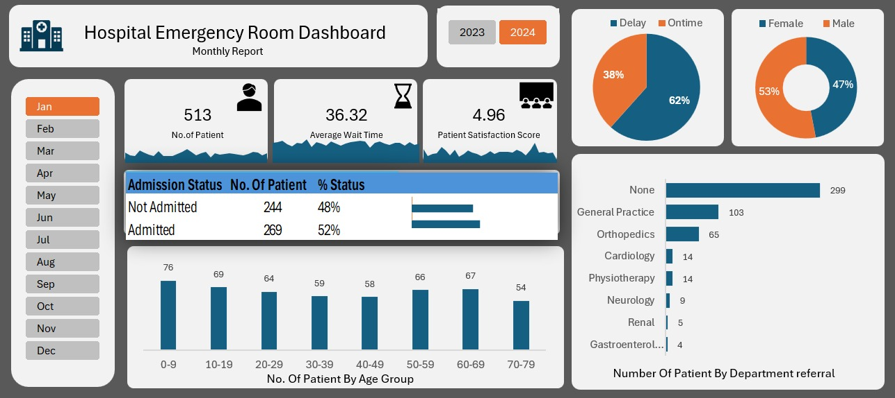

# 🏥 Hospital Emergency Room Analytics Dashboard (Excel)

An interactive Excel dashboard that helps hospital administrators track ER patient flow, wait times, and compliance with a **30-minute wait-time SLA**.



---

## 📌 Business Problem

ER teams generate thousands of patient records, but raw data doesn't tell an administrator:

- Are we meeting our 30-minute wait-time target?
- Which departments receive the most referrals?
- How do volume and wait times change across months and patient age groups?

This dashboard answers those questions in one view.

---

## 💡 Key Findings

| Metric | Result |
|---|---|
| Total patient visits analysed | **9,216** (Apr 2023 – Oct 2024) |
| Average wait time | **35.3 minutes** (about 5 min above the SLA) |
| Visits that missed the 30-min SLA | **59.3%** (5,467 visits) |
| Patients waiting more than 45 min | **~30%** |
| Referral concentration | **74%** of referred patients went to **General Practice (48%)** and **Orthopedics (26%)** |

**Takeaway:** roughly 6 in 10 patients waited longer than the target, so the hospital is missing its own SLA in most visits. Staffing changes around General Practice and Orthopedics referrals would affect the largest share of patients.

> Note: 5,400 visits have no referral department, so referral percentages are calculated on the 3,816 referred patients.

---

## 🛠️ Tools & Skills Used

- **Excel** – dashboard design, PivotCharts, slicers
- **Power Query** – data cleaning and transformation (ETL)
- **Power Query M** – dynamic Calendar Table using `List.Dates`
- **Power Pivot** – data model with 1-to-many relationships
- **DAX** – calculated columns for age brackets and SLA status

---

## ⚙️ How I Built It

### 1. Data Cleaning (Power Query)
- Loaded raw ER visit records (9,216 rows)
- Audited column quality and fixed inconsistent text entries
- Split the date-time field into separate date and time columns

### 2. Calendar Table (M Code)
- Built a 2-year Calendar Table with `List.Dates`
- Makes time-series charts accurate even on dates with no visits

### 3. Data Model (Power Pivot + DAX)
- Created 1-to-many relationship between the Calendar Table and the visits table
- Added a calculated column grouping patients into **10-year age brackets**
- Added a calculated column labelling each visit **On-Time** or **Delayed** against the 30-minute SLA

### 4. Dashboard
- KPI cards: total visits, average wait time, SLA compliance %
- Trend area chart across months
- Demographic breakdown by age bracket
- Department referral breakdown
- Month and Year slicers connected across all visuals

---

## 📂 Repository Structure

```
├── README.md
├── Hospital_ER_Dashboard.xlsx        # Final dashboard
├── Hospital_Emergency_Room_Data.csv  # Raw dataset
├── Dashboard_Preview.pdf             # PDF export (view without Excel)
└── images/
    └── dashboard.png
```

---

## ▶️ How to Open

1. Download `Hospital_ER_Dashboard.xlsx`
2. Open in **Excel for Windows** (Power Pivot is not available in Excel for Mac or Excel Online)
3. Use the Month and Year slicers to filter the dashboard

If you can't open it, see `Dashboard_Preview.pdf`.

---

## 🙏 Acknowledgements

Built while learning from Satish Dhawale's Excel project tutorial (Skill Course). Dataset and project structure follow the course; the analysis, findings, and write-up are my own.

---

## 📬 Connect

**Sneha** – CS Engineering student (UIT-RGPV), aspiring Business Analyst
🔗 LinkedIn: [add your profile link]
